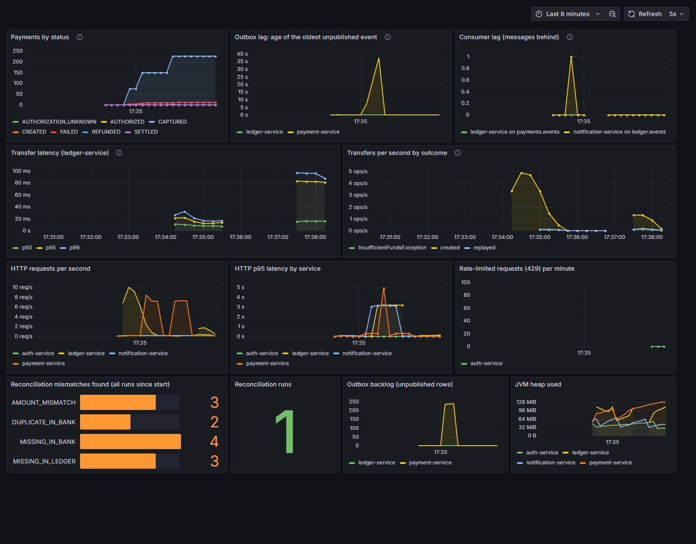
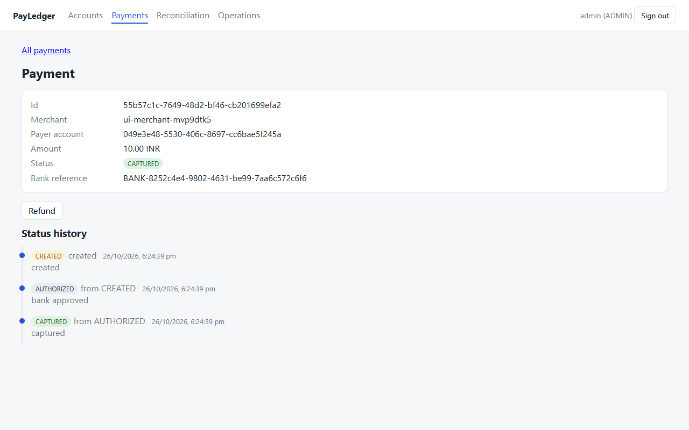
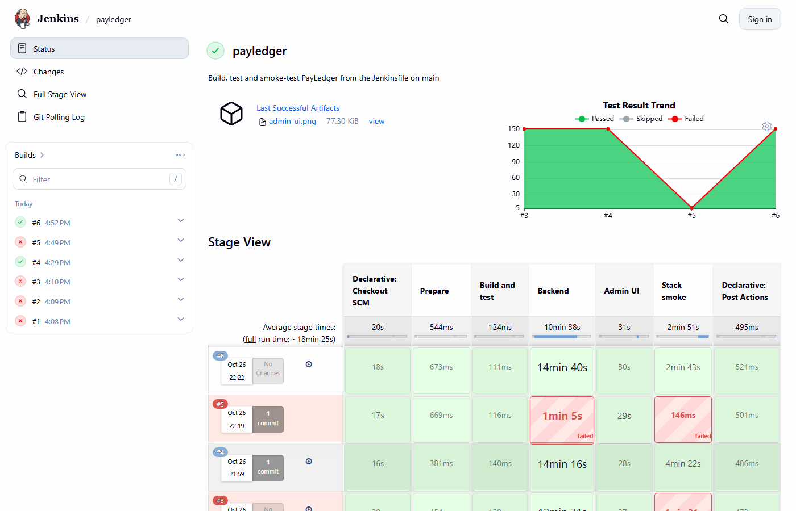
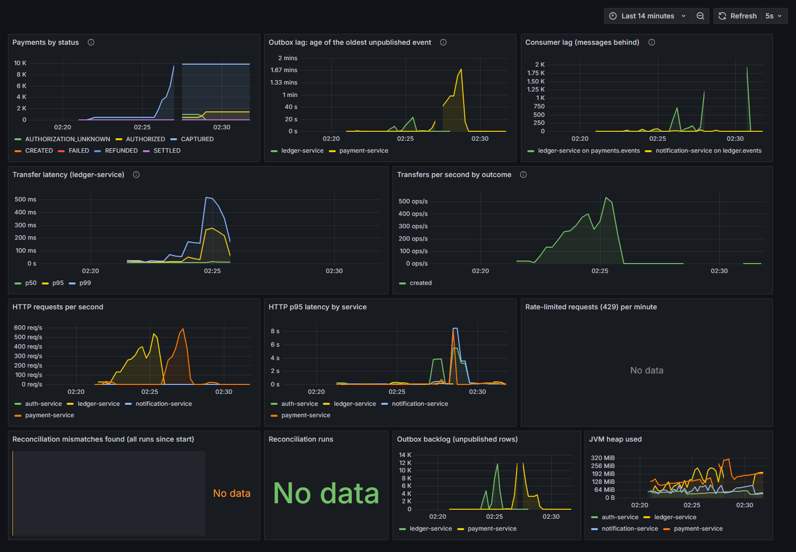

# PayLedger

A payments platform with a double-entry ledger: payments are authorized and captured against a (stand-in) bank, and every capture becomes a balanced, append-only journal entry in a separate ledger service. Built to show what stays correct when things fail: duplicate requests, a bank that times out, a consumer killed mid-stream, concurrent transfers on one account.

**Stack:** Java 21, Spring Boot 3, PostgreSQL, Kafka, Spring Batch, Spring Security (JWT), React + TypeScript, Docker Compose, Prometheus, Grafana, Jaeger, Testcontainers, Gatling, Jenkins and GitHub Actions.

**Where to look:** [architecture and diagrams](docs/architecture.md) · [23 decision records](docs/decisions/README.md) · [all measurements](docs/results.md) · [demo script](docs/demo-script.md)

## What was measured

| Claim | Result |
|---|---|
| Concurrent transfers, threads, balance drift | 27,000 transfers per strategy, 64 threads, **0 drift** |
| Pessimistic vs optimistic locking on a hot account | 75 vs 32 transfers/s (and 32% of optimistic transfers abandoned) |
| Generated scenarios checked against the ledger invariants (jqwik) | 10,000, **0 violations** |
| 50 identical parallel payment requests | **1** payment, 1 bank call |
| 1,000 payments against a flaky bank (5% declines, 3% timeouts, 1% lost answers) | about 35 left unknown, all resolved by asking the bank, **0 stuck** |
| Ledger consumer killed with 471 events still to process | **0 lost, 0 duplicated** postings (300 payments, 900 events) |
| Bank reconciliation with planted errors | 11 of 11 found in a 40-capture demo (19 of 19 in the 200-capture test), 0 false positives |
| Load, `POST /transfers` (one laptop, everything on it) | **600 requests/s** sustained, p95 44 ms, p99 234 ms; degrades at 800/s |
| Load, payment create + capture (same machine) | **120 payments/s** (240 requests/s) sustained, p95 73 ms; the edge is between 120 and 360/s |
| Correctness under load | 11,250 payments, 33,679 events: **0 lost, 0 duplicated**, balances sum to 0 |
| Tests / coverage | **152 tests**, 92.8% of lines and 82.2% of branches (JaCoCo) |

Load numbers describe one laptop whose Docker VM runs the load generator, database, Kafka and all services; how they were measured, what the failed attempts taught, and the caveats are in [docs/results.md](docs/results.md).

## Run
```bash
cp .env.example .env   # fill in every value, e.g. openssl rand -hex 16
docker compose up -d --build
docker compose ps      # all services healthy
```
Health: `:8081` payment, `:8082` ledger, `:8083` notification, `:8084` auth (`/actuator/health`). Admin console `:8085`, Prometheus `:9090`, Grafana `:3000`. If you ran an older version, run `docker compose down -v` once: the database roles for auth and notifications are only created on a fresh volume.

## Test
```bash
./mvnw verify          # needs Docker running (Testcontainers)
```

## Locking strategy
`LEDGER_LOCKING_STRATEGY=PESSIMISTIC` (default) or `OPTIMISTIC` selects how `POST /transfers` serialises concurrent updates to the same account. Trade-offs and measurements: `docs/decisions/0009-pessimistic-vs-optimistic.md`, `docs/results.md`.

## Security (auth-service, :8084)
Every API needs a JWT from auth-service (ADR 0018, 0019). The first user, `admin` (role ADMIN), is created from `AUTH_ADMIN_PASSWORD` in `.env`; only an ADMIN creates other users (roles USER, MERCHANT, ADMIN).
```bash
ADMIN=$(curl -s -X POST localhost:8084/auth/token -H 'Content-Type: application/json' \
  -d "{\"username\":\"admin\",\"password\":\"$AUTH_ADMIN_PASSWORD\"}" | sed 's/.*"accessToken":"\([^"]*\)".*/\1/')
curl -X POST localhost:8084/auth/users -H "Authorization: Bearer $ADMIN" -H 'Content-Type: application/json' \
  -d '{"username":"m1","password":"a-long-enough-password","role":"MERCHANT"}'
```
The token's subject is matched with the owner of accounts (ledger `owner_id`) and payments (`merchantId`): a USER sees only their own wallet, a MERCHANT only its own payments, an ADMIN everything and the operator endpoints (`/recon/*`, `/admin/*`, account freeze). Money-moving endpoints are rate limited per client (429 with `Retry-After`). Tokens last 15 minutes.

## Payments (payment-service, :8081)
Log in as a MERCHANT user (above), put its name in `merchantId`, and send its token:
```bash
curl -X POST localhost:8081/payments -H 'Content-Type: application/json' \
  -H "Authorization: Bearer $MERCHANT_TOKEN" -H 'Idempotency-Key: pay-1' \
  -d '{"merchantId":"m1","payerAccountId":"00000000-0000-0000-0000-000000000042","amount":500.00,"currency":"INR"}'
```
Then `POST /payments/{id}/capture`, `POST /payments/{id}/refund`, `GET /payments/{id}/events`. The stand-in bank lives at `/mock-bank` and fails on purpose (declines, timeouts, lost responses; see `MOCK_BANK_*` in `docker-compose.yml`). A 202 means the bank's answer is unknown; the status-check job resolves it.

## Events: outbox, Kafka, ledger consumer
Every payment state change writes an outbox row in the same database transaction; a poller publishes the rows to the `payments.events` topic (at least once). The ledger consumes them idempotently (`processed_events`), posts `PAYMENT_CAPTURE` / `REFUND` journal entries, and sends events it cannot apply to `payments.events.DLT`. After fixing the cause (for example creating the missing merchant account), `POST localhost:8082/admin/dlt/replay` re-queues them. Design: `docs/decisions/0013-transactional-outbox.md`, `0014-idempotent-ledger-consumer.md`.

Prove it yourself (kills the ledger mid-stream and checks 0 lost, 0 duplicated; uses its own compose project):
```bash
ops/chaos/kill-ledger.sh 300
```
Ledger payments need a MERCHANT account whose `ownerId` equals the payment's `merchantId`.

## Notifications and traces
Every journal entry the ledger posts also queues a `ledger.entry.posted` event (ledger outbox); notification-service consumes it and stores two mock emails (`[MOCK EMAIL]` in its log, rows in the `notifications` database). All three services export traces to Jaeger (http://localhost:16686 when the stack is up). The trace id travels through the outbox rows and Kafka headers, so one payment capture is a single trace across payment-service, ledger-service and notification-service.

Prove it (own compose project, fresh volumes):
```bash
ops/e2e/trace-check.sh
```
After upgrading from M4: Postgres only creates its databases on a fresh volume, so run `docker compose down -v` once to get the `notifications` database, and add `NOTIFICATIONS_DB_PASSWORD` to your `.env` (see `.env.example`).

## Bank reconciliation
`POST /recon/runs` (multipart `file` plus `periodStart` and `periodEnd`) compares the bank's settlement CSV (`external_ref,amount_minor,currency,settled_at`) with the ledger's `PAYMENT_CAPTURE` entries for that period and stores one outcome per reference: `MATCHED`, `MISSING_IN_LEDGER`, `MISSING_IN_BANK`, `AMOUNT_MISMATCH` or `DUPLICATE_IN_BANK`. Read it back with `GET /recon/runs/{id}` and `GET /recon/runs/{id}/items?outcome=...` (mismatches by default). Submitting the same file for the same period again returns the same run; a run that failed part-way is resumed, not repeated. Design: `docs/decisions/0017-bank-reconciliation.md`.

Try it end to end (plants errors in a generated bank file and checks every one is found; own compose project):
```bash
ops/recon/run-demo.sh 40
```

## Observability: metrics and dashboard
Every service exposes Prometheus metrics at `/actuator/prometheus`; Prometheus (:9090) scrapes them and Grafana (:3000, read-only without login) loads `ops/grafana/dashboards/payledger.json`.



Taken from `ops/observability/dashboard-demo.sh`: payments with bank faults, Kafka stopped for a while (outbox lag), ledger-service killed during traffic (consumer lag), a reconciliation run with planted errors (3 amount mismatches, 2 duplicates, 4 missing in bank, 3 missing in ledger), and a burst of bad logins (429). The same script runs every dashboard query against Prometheus and fails if one is empty.

| Metric | Meaning |
|---|---|
| `payments_by_status{status}` | payments in each status (from the database) |
| `ledger_transfer_duration_seconds` | transfer latency histogram, tagged `outcome` (created, replayed, refusal type) |
| `outbox_oldest_unpublished_age_seconds`, `outbox_unpublished` | outbox lag and backlog (payment and ledger) |
| `kafka_consumer_group_lag{group,topic}` | messages the consumer group is behind, asked of the broker |
| `recon_mismatches_total{outcome}`, `recon_runs_total{status}` | reconciliation results |

Consumer log lines carry the trace id of the request that caused the event, so one id finds the HTTP call, the outbox publish, the ledger posting and the notification. Decisions: [ADR 0020](docs/decisions/0020-observability.md).

## Admin console (admin-ui, :8085)
React + TypeScript + Vite, served by nginx, which also forwards `/api/<service>/` to the services so the browser stays on one origin ([ADR 0021](docs/decisions/0021-admin-ui.md)). Sign in with a user from auth-service (the bootstrap `admin` sees everything; a MERCHANT sees only its own payments).



- **Accounts:** balances, owner and type filters, freeze and unfreeze.
- **Payments:** status filter, detail with the full status history, capture and refund where the state allows.
- **Reconciliation:** run list with counts, mismatches of a run, upload of a bank settlement file.
- **Operations:** dead-letter replay.

Development: `cd admin-ui && npm ci && npm run dev` (proxies to services on localhost). Smoke test: `ops/ui/smoke.sh` starts the stack in its own compose project and runs the Playwright test against it using the installed Microsoft Edge.

## CI/CD: Jenkins
The pipeline is in the [`Jenkinsfile`](Jenkinsfile) and Jenkins itself is code in [`jenkins/`](jenkins) ([ADR 0022](docs/decisions/0022-jenkins.md)); GitHub Actions (`ci.yml`) also builds every push.



```bash
docker compose -f jenkins/docker-compose.yml --env-file .env up -d --build   # http://localhost:8090
```

Stages: throwaway `.env` with random secrets, then Maven `verify` (all backend tests with Testcontainers) in parallel with the admin-ui type-check and build, then the real-stack Playwright smoke test (`ops/ui/smoke.sh`). Jenkins reaches Docker through the host's socket, polls the repository every five minutes, and is configured entirely by `jenkins/jenkins.yaml` (sign in as `admin` with `JENKINS_ADMIN_PASSWORD` from `.env`; anyone on localhost can view).

## Load test
`ops/load/run.sh` starts the stack in its own compose project, drives transfers and payments with Gatling at rising rates (one run per rate, from a rested system, stopping at the first rate that is over the limit), then checks that nothing was lost or duplicated and that all balances sum to zero. Quick run: `RATES_TRANSFERS=100,200 RATES_PAYMENTS=60,120 STEP_SECONDS=10 ops/load/run.sh`. Results and method: [docs/results.md](docs/results.md).



The dashboard over the final run: request rates climb through the ladders, latency rises at the end of each, and under overload the outbox lag reached about 1.7 minutes and consumer lag about 2,000 messages before everything drained (the reconciliation panels are empty because this run does not reconcile).

## Deployment
One VM with Docker Compose and Caddy (automatic HTTPS); only ports 80 and 443 are public. Kit, runbook and what is exposed: [deploy/README.md](deploy/README.md), [ADR 0023](docs/decisions/0023-deployment.md). Check a deployment from outside with `ops/deploy/smoke-remote.sh <url>`.
