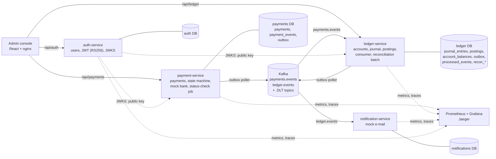
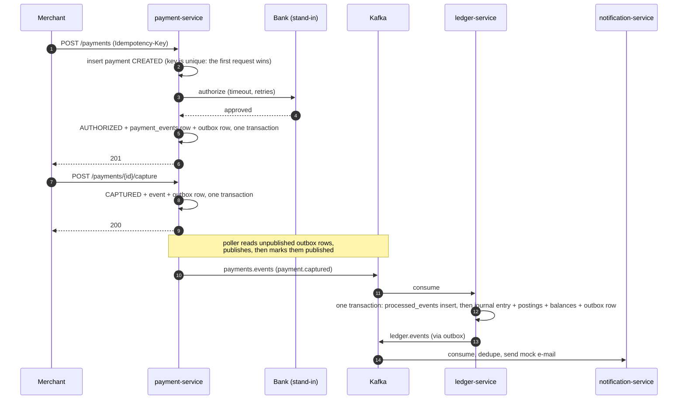
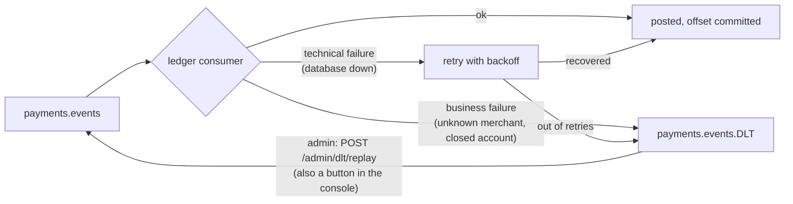
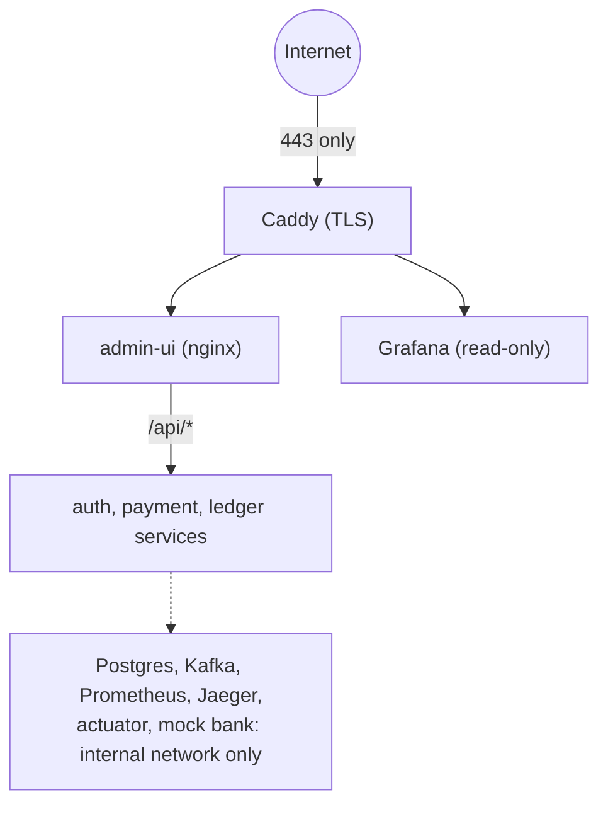

# Architecture

PayLedger is a payments platform with a double-entry ledger. Four Spring Boot services, each with its own database, talk to each other through Kafka; the only synchronous call between services is payment-service calling its (stand-in) bank. Decisions behind each choice are in [`decisions/`](decisions/README.md).

## Components and data ownership

Each service owns its tables; nothing reads another service's database. The token's signing key exists only in auth-service; the others fetch the public key and can verify but not forge tokens ([ADR 0018](decisions/0018-identity-and-tokens.md)).

## A payment, from request to ledger

What makes this safe:

- **No dual write.** The state change and the outbox row are one database transaction; nothing is published to Kafka inside a transaction ([ADR 0013](decisions/0013-transactional-outbox.md)). A crash after commit loses nothing: the poller finds the row on restart (at-least-once).
- **Duplicates are harmless.** The consumer inserts the event id into `processed_events` in the same transaction as the posting, so a redelivered event is ignored ([ADR 0014](decisions/0014-idempotent-ledger-consumer.md)). The chaos test kills the ledger with events in flight: 0 lost, 0 duplicated.
- **Timeouts are not guesses.** If the bank call times out the payment becomes `AUTHORIZATION_UNKNOWN`; a job asks the bank what happened instead of assuming ([ADR 0010](decisions/0010-payment-state-machine.md)).

## The ledger

Money is `long` minor units. Every transfer writes one `journal_entries` row and two `postings` (debit, credit) in a single transaction; a deferred database trigger rejects an unbalanced entry, and other triggers make the journal append-only (corrections are reversal entries). Balances are kept in `account_balances` and updated under row locks taken in sorted account-id order, so concurrent transfers cannot deadlock ([ADR 0003](decisions/0003-balance-sign-convention.md), [ADR 0007](decisions/0007-lock-acquisition.md)). A second, optimistic-locking strategy exists and was measured against it ([ADR 0009](decisions/0009-pessimistic-vs-optimistic.md)).

## When the consumer fails

Replay is safe to repeat because of `processed_events`.

## Security boundaries

- Every API call needs a JWT; roles are `ADMIN`, `MERCHANT`, `USER`. Ownership (a merchant sees only its own payments, a user only their own wallet) is checked in the service layer, so it holds for any entry point ([ADR 0019](decisions/0019-authorization-rate-limits-audit-logs.md)).
- Rate limits (Bucket4j) return 429 with `Retry-After`; privileged actions go to an append-only audit log; a test asserts that no password, token or card-like number reaches the logs.
- The mock bank accepts only calls carrying a shared key; nginx and Caddy never forward it or any actuator path.

## Observability

Metrics (payments by status, transfer latency histogram, outbox lag, consumer lag, reconciliation mismatches) go to Prometheus and one provisioned Grafana dashboard; every log line carries the trace id, and one trace follows a request across payment, ledger and notification through the outbox and Kafka headers ([ADR 0016](decisions/0016-tracing-across-the-outbox.md), [ADR 0020](decisions/0020-observability.md)).
